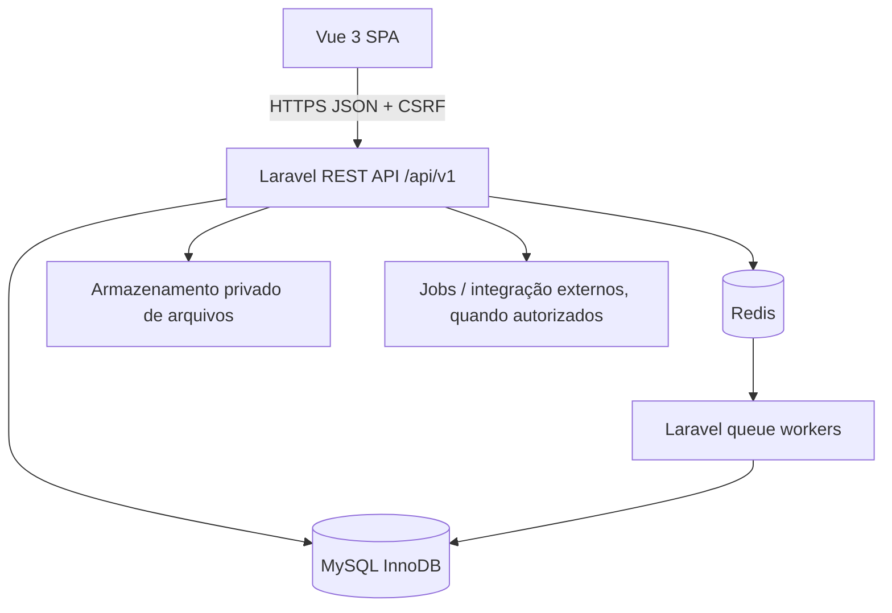

# 01 — Arquitetura técnica

## Decisões
Monorepo com API Laravel 13 (PHP >=8.3) e SPA Vue 3/TS. MySQL 8.4 InnoDB como fonte transacional, Redis para cache, locks e filas. Monólito modular, sem microsserviços prematuros. Gestão de aplicações com Git; ambiente local containerizado só para serviços auxiliares na primeira fase.

```text
FactoryControl_PRO/
  AGENTS.md
  apps/
    api/       # Laravel 13 — gerado na Fase 0
    web/       # Vue 3 + Vite — gerado na Fase 0
  infra/
    compose.yaml
    .env.example
  docs/
  tasks/
  prompts/
  scripts/
```

## Estrutura lógica da API proposta
```text
app/
  Domain/
    Catalog/ Inventory/ Purchasing/ Manufacturing/ Quality/
    Commercial/ Finance/ People/ Maintenance/ Analytics/
  Http/Controllers/Api/V1/
  Http/Requests/
  Policies/
  Jobs/
  Events/
  Listeners/
```
Não é necessário criar todas as pastas vazias. Modelos do Eloquent podem ficar no domínio com namespace consistente. Controllers delegam a actions/services com regras transacionais testáveis.

## Fluxo de componentes


## Autenticação e isolamento
- Primeira parte: Sanctum session cookies HttpOnly com CSRF para SPA; ambiente local preparado para CORS/Sanctum stateful domains quando API e web diferem.
- Filtragem de `company_id` (autorizado) em endpoints e consultas; nenhuma seleção do frontend substitui autorização de backend.
- RBAC permissões granulares; alto privilégio exige trilha de auditoria; princípio do menor acesso.

## Concorrência e idempotência
Movimentos/OPs/sales/receipts: transação MySQL, row locks quando necessário, índices únicos e chave de idempotência para POSTs suscetíveis a duplicação. Retentativas de job sem gerar eventos repetidos.

## Cálculos e relatórios
KPIs transacionais precisos nos serviços; consultas agregadas indexadas. Dashboard com cache curado e data de atualização visível. No crescimento, adicionar snapshots/sumários incrementais sem substituir o livro transacional. Não executar queries pesadas diretamente a cada render.

## Ambientes
`local`, `testing`, `staging` e `production`, com credenciais isoladas. Em produção: HTTPS, MySQL privado, backups e monitoramento, queue worker e scheduler persistentes. Deploy e topologia Hostinger só depois de levantamento de capacidades.

## Política de versões
Fixar versões realmente instaladas no lockfile. Documentação de compatibilidade: https://laravel.com/docs/13.x/releases, https://dev.mysql.com/doc/refman/8.4/en/, https://developers.openai.com/codex/ .
